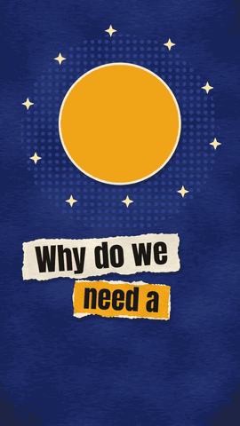

<div align="center">

# 📰✂️ Paper Collage Video

### Vox-style explainers & lyric videos with your AI agent. **No API key. No credits. 100% local.**

<p>
  
  
  
  
</p>

<table>
<tr>
<td align="center"><br><b>Lyric video</b> (Hindi)</td>
<td align="center"><br><b>Explainer</b> (code only, zero pictures)</td>
</tr>
</table>

**Type one sentence → get a finished, beat-synced paper-collage video.**

[▶ Full demo with sound](assets/demo-leap-year.mp4) · [Install](#-install-2-minutes) · [How it works](#-how-it-works) · [Examples](examples/)

</div>

---

## 😩 The problem
Collage explainers and kinetic lyric videos are everywhere on Reels, Shorts and TikTok. Making one means
After Effects skills, or chaining paid AI tools that **eat credits and need API keys**.

## ✨ The fix
An open **agent skill**: you ask Claude Code (or Codex, or any agent that reads `SKILL.md`) in plain words,
and it builds the video **on your own computer**:

- ✂️ **Torn paper, scissor-cut stickers, tape, halftone dots**: the editorial collage look
- 🥁 **On the beat**: every word and picture slaps down on a detected beat of *your* song or voice-over
- 🎥 **Not a slideshow**: one scrapbook wall, the camera whips between patches, then pulls back to reveal it all
- 🌏 **Any language**: Hindi / Devanagari and English fonts bundled, any Fontsource font for other scripts
- 🖼️ **Your photos, your video frames, or none at all**: built-in props (sun, moon, heart, clock, calendar,
  lamps, marigolds, stars, confetti) make a full video from pure code
- 💸 **$0**: Remotion + free Python tools (librosa, rembg, faster-whisper). Nothing calls a paid API.

## 💬 Just ask
> "Make a 45-second paper-collage lyric video from `song.mp3`, 0:37 to 1:22. Here are the lyrics: …"

> "Make a Vox-style explainer on why we have leap years, 9:16, with my voice-over `vo.m4a`."

> "Turn these 5 photos into a scrapbook Reel synced to `track.mp3`."

> "मेरे गाने का कोलाज लिरिकल वीडियो बनाओ" (works in Hinglish / Hindi too)

The agent asks for anything missing, shows a short rundown for you to approve, builds it, checks frames, and
renders `renders/video.mp4`.

## 🚀 Install (2 minutes)
You need **Node.js 18+**, **ffmpeg** and **Python 3.9+**.

```bash
git clone https://github.com/satyasanatan989/paper-collage-video.git
pip install numpy pillow scipy librosa soundfile        # required
pip install rembg onnxruntime faster-whisper            # optional: photo cut-outs, voice timing
python paper-collage-video/scripts/check_setup.py
```

Then give it to your agent:
- **Claude Code**: copy the folder to `~/.claude/skills/paper-collage-video/` (all projects) or `.claude/skills/` in one project.
- **Codex / other agents**: keep the folder in your project; the agent reads `AGENTS.md`.

**Try it without an agent:**
```bash
cd paper-collage-video/template
npm install
npx remotion studio                            # preview and scrub
npx remotion render Collage renders/demo.mp4   # render the leap-year demo
```

## 🧠 How it works
```
your song / voice-over ─▶ beats.py (beat grid) ─▶ transcribe.py (word times, optional, offline)
your photos / frames   ─▶ cutout.py (stickers + torn scraps, local rembg)
your palette           ─▶ textures.py (torn sheets, word strips, newsprint wall)
                                 │
                                 ▼
               src/storyboard.json  (stations · words · pictures · props, each on a beat)
                                 │
                                 ▼
               Remotion engine (Collage.tsx) ─▶ renders/video.mp4
```

| Folder | What's inside |
|---|---|
| [`SKILL.md`](SKILL.md) | the workflow your agent follows |
| [`references/`](references/) | storyboard schema, style guide, lyric & explainer guides, cut-outs, troubleshooting |
| [`scripts/`](scripts/) | setup check, beats, transcription, cut-outs, textures, review contact sheet, demo audio |
| [`template/`](template/) | the Remotion project copied for every new video |
| [`examples/`](examples/) | a code-only explainer and a full lyric-video storyboard |

## 🆚 Why not the API-based tools?
| | This skill | Typical AI video pipelines |
|---|---|---|
| API keys | **none** | 1-3 paid keys |
| Cost per video | **$0** | credits per image, clip, voice, song |
| Sync to music | **beat-detected, frame-exact** | approximate |
| Same result every render | **yes (deterministic)** | no |
| Edit afterwards | **change a JSON line, re-render** | regenerate and pay again |

## 🙏 Good practice
- Use songs you own or have the rights to, and credit the artists when you post.
- Use your own photos, or public-domain images. The lyric showcase art above was made from the author's own
  AI-generated clips (Google Flow); if you use AI images, say so when posting.
- "Vox-style" describes a look. Don't put another brand's logo or name in your videos.
- Remotion is free for individuals and small teams; bigger companies need a [Remotion licence](https://www.remotion.dev/license).

## ⭐ Like it?
If this saved you credits, **star the repo** so other creators can find it, and share what you make.
Issues and pull requests (new props, fonts, palettes, languages) are very welcome.

## 📄 Licence
MIT, see [`LICENSE`](LICENSE). Fonts are under the SIL Open Font License via Fontsource.
